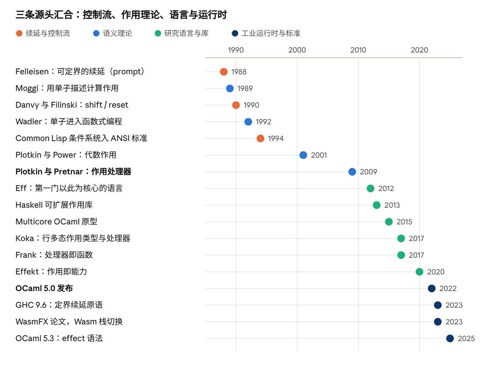
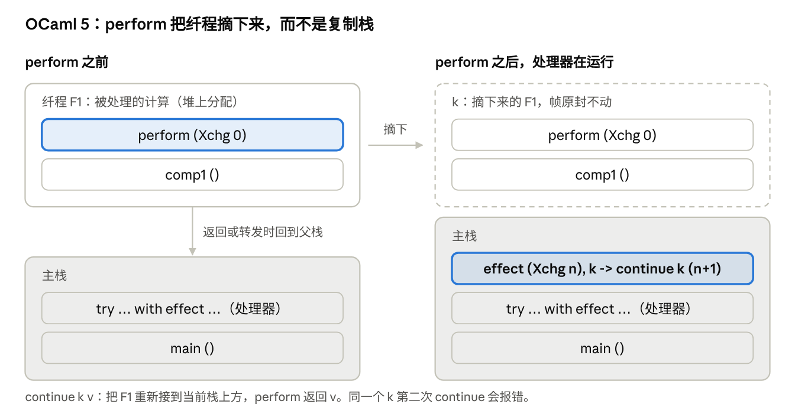

# 代数作用：历史、功能与实现

2026-10-27 · AI 协作整理（Claude）

**代数作用（algebraic effects）加上作用处理器（effect handlers）**，是一种把“要做什么”和“怎么做”分开的控制流机制：代码用 `perform` 发出一个请求，调用栈上方最近的处理器决定怎么响应，并且拿到“剩下的计算”（续延，continuation），可以恢复它、丢弃它，甚至恢复多次。最直观的理解是**可以恢复的异常**。这一个机制能统一异常、可变状态、生成器、async/await、回溯搜索、依赖注入和测试替身。

它的理论来自 Plotkin 与 Power（2001–2003）和 Plotkin 与 Pretnar（2009）；研究语言 Eff、Koka、Frank、Effekt、Unison 把它做成了语言特性；2022 年的 OCaml 5 第一次把它放进一门工业语言的运行时；WebAssembly 的栈切换提案用同一套思想设计，目前处于 Phase 3。实现上有三条路：把程序改写成续延传递风格（CPS）、在运行时切换调用栈（纤程）、把处理器当参数传下去（证据传递）。OCaml 5 的实测是：不用作用的程序平均只慢约 1%，一次 perform 加恢复在十几纳秒量级。

## 一分钟看懂

先看异常。`throw` 把控制权交给调用栈上方最近的 `catch`，中间的栈帧全部被丢掉，再也回不去。代数作用只改了一点：**处理器拿到一个对象 `k`，代表“从 perform 那一点往后的全部计算”**。调用 `k(值)`，程序就带着这个值回到 perform 的位置接着跑。

下面用一种接近 JavaScript 的伪代码说明（JS 本身没有这个特性）：

```
function greet() {
  const name = perform AskName();      // 发出请求，暂停在这里
  return "你好，" + name;
}

try {
  print(greet());
} handle (AskName, k) {               // 拿到请求和“剩下的计算” k
  k("阿杰");                          // 带着值回到 perform 处继续
}
// 输出：你好，阿杰
```

要点有三个：

- **调用方不知道谁来回答。** `greet` 只声明“我需要一个名字”，是从配置读、从网络取，还是在测试里写死，由外层的处理器决定。
- **中间的函数不用改。** 如果 `greet` 是被十层函数间接调用的，这十层都不用加参数、也不用标成 async。
- **处理器控制了“之后”。** 它可以立刻恢复（像一次函数调用）、先把 `k` 存起来过一会儿再恢复（像 async/await）、不恢复（像异常），或者用不同的值恢复多次（像回溯搜索）。

同一个例子在 OCaml 5.3 里是真实可运行的代码（取自 OCaml 手册）：

```
open Effect
open Effect.Deep

type _ Effect.t += Xchg : int -> int t      (* 声明一个作用：给一个 int，换回一个 int *)

let comp1 () = perform (Xchg 0) + perform (Xchg 1)

let () =
  let r = try comp1 () with
    | effect (Xchg n), k -> continue k (n + 1)   (* 处理：拿到 n，用 n+1 恢复 *)
  in print_int r                                    (* 1 + 2 = 3 *)
```

这里 `continue k (n + 1)` 就是“带着值回去”。两次 perform 分别拿到 1 和 2，结果是 3。

## 历史渊源

代数作用不是凭空出现的，它是三条线索的汇合。



**第一条：续延与控制流。** 续延是“程序接下来要做的全部事情”，在 1960–70 年代就被用来描述跳转和异常。Scheme 的 `call/cc` 把它做成了可以拿在手里的值，但它抓的是“全部剩余计算”，很难组合。1988 年 Felleisen 提出可定界的续延：先在栈上放一个标记（prompt），只抓取到标记为止的那一段；1990 年 Danvy 与 Filinski 的 `shift/reset` 也是同一类。这就是后来作用处理器的“机器层”：处理器就是一个带名字的 prompt。另一个常被提起的先驱是 Common Lisp 的条件系统：处理器在不展开栈的情况下运行，由它选一个“重启点”让程序继续，已经很像“可以恢复的异常”，只是没有把续延交给处理器。

**第二条：作用的语义理论。** 1989 年 Moggi 用单子（monad）统一描述异常、状态、非确定性等“计算作用”，Wadler 把它带进了函数式编程，Haskell 的 IO 就是这样来的。但单子不容易组合，叠加几种作用要靠单子变换器。Plotkin 与 Power 在 2001–2003 年换了一个角度：大多数作用可以用**一组操作加上它们满足的等式**来刻画，比如状态就是 `get` 和 `put` 两个操作。“代数”这个词就来自这里：操作是代数的运算，等式是代数的公理。

缺的一块是“处理”：异常可以被 catch，但当时的理论里没有对应的东西。Plotkin 与 Pretnar 的 ESOP 2009 论文补上了它：处理器给出这套操作的一个“解释”，把一段只会发出操作的计算，翻译成具体的结果。异常处理只是其中一个特例。从此「作用」和「处理器」成为一对。

**第三条：语言与运行时。**

- 2012 年 Bauer 与 Pretnar 做出 Eff，第一门以作用和处理器为核心的语言，用它写出了异常、状态、回溯、协作式多线程和概率选择。
- 2013 年前后 Haskell 社区出现“可扩展作用”库，用自由单子模拟处理器，试图替代单子变换器。
- 2015 年 Multicore OCaml 项目发现，作用处理器正好可以拿来写并发调度器，不必把特定的线程库做进语言。
- 2017 年前后 Koka（微软研究院 Leijen）、Frank、Links 等语言把作用类型系统做成熟；2020 年 Effekt 把作用当成“能力”传递，让类型更轻。
- 2019 年 Dan Abramov 的博客《Algebraic Effects for the Rest of Us》让前端社区知道了这个词，并把 React 的 Hooks 和 Suspense 解释成它的影子。
- 2022 年 12 月 OCaml 5.0 发布，第一次在一门工业语言的正式运行时里提供作用处理器，并发调度交给 Eio 等库用它来写，而不把某一种线程模型写死在语言里；2025 年 1 月的 5.3 又加上了 `effect` 关键字语法。
- 2023 年 GHC 9.6 加入 `prompt#` 和 `control0#` 等定界续延原语，给 Haskell 的作用库用；同年 WasmFX 论文把作用处理器做进 WebAssembly 的指令集，它演变成的栈切换提案目前处于 Phase 3。

一句话概括：**理论上它是“单子的可组合替代品”，机制上它是“带名字的定界续延”，工程上它是“可以恢复的异常”。**

## 核心概念

**作用（effect）与操作（operation）。** 一个作用是一组操作的签名，每个操作写成“交出什么、换回什么”。状态是 `get : () → S` 和 `put : S → ()`；异常是 `raise : E → ⊥`（永远不返回）；非确定选择是 `flip : () → bool`；生成器是 `yield : T → ()`。签名只说“能做什么”，不说“怎么做”。

**处理器（handler）。** 处理器给每个操作一条处理规则，再加一条“返回规则”（被处理的计算正常结束时怎么包装结果）。同一组操作可以有很多处理器：状态可以用一个可变单元实现，也可以用“传递参数的函数”实现，还可以记录每次读写用来做审计。处理器没有认领的操作会继续向外转发，所以处理器可以一层层叠起来。

**续延（continuation、resumption）。** 处理规则拿到的 `k`，是“从 perform 到这个处理器为止”的那一段调用栈，封装成一个可以调用的值。它是定界的：处理器本身就是那个界。

**“代数”是什么意思。** 理论上，一个操作是“代数的”，指它和外面的计算上下文可以交换：“先做 op，再把结果交给后面的计算”，等于“把后面的计算推进 op 的每个可能结果里”。比如 `flip()` 有真、假两种结果，后面的计算就可以看成两个分支，处理器拿到的 k 正是“分支里的那段计算”。一个简单的判断标准是：操作的参数都是普通值，不是一段待执行的程序。`get`、`put`、`raise`、`flip` 都是代数的；`catch`、`local`（临时改一下环境再跑一段子计算）这类“收一段程序作参数”的操作就不是，叫高阶作用或作用域作用，是目前仍在研究的边界。另外，理论里的“等式”（比如连续两次 `put` 等于只留第二次）在实际语言里几乎都不检查，工程上说的“代数作用”，大多只指“操作加处理器”这套机制。

几个常见的设计维度：

| 维度 | 选项 | 含义 | 代表 |
| --- | --- | --- | --- |
| 深 / 浅 | 深处理器 | 恢复后，同一个处理器继续管后面的操作；相当于对计算树做一次折叠 | Koka、Eff、OCaml 的 `Effect.Deep` |
|  | 浅处理器 | 只管第一个操作，恢复时要重新指定处理器；适合状态机、协议 | OCaml 的 `Effect.Shallow`、Frank |
| 恢复次数 | 单次（one-shot） | `k` 最多恢复一次；实现可以直接切栈，不用复制 | OCaml 5（重复恢复会报错）、WasmFX |
|  | 多次（multi-shot） | `k` 可以恢复多次；能写回溯、概率编程，但要复制或重算栈 | Koka、Eff、Effekt |
| 尾部恢复 | 尾恢复（tail-resumptive） | 处理规则的最后一步就是 `k(v)`，等价于一次普通函数调用；编译器可以直接就地执行，不抓续延 | Koka 的主要优化对象 |
| 类型 | 有作用类型 | 函数类型写明会发出哪些作用，漏处理在编译期发现 | Koka、Effekt、Unison、Eff |
|  | 无作用类型 | 类型里不出现作用；没人处理的 perform 在运行时报错 | OCaml 5 |
| 处理器绑定 | 动态绑定 | perform 找调用栈上最近的对应处理器 | 大多数语言 |
|  | 词法绑定 | 处理器作为“能力”传到用它的地方，避免被中间的同名处理器意外截住 | Effekt |

其中最影响实现的是**单次 / 多次**：只允许单次恢复，就能把续延当成一段可以接回去的栈，这是 OCaml 5 和 WasmFX 的选择；要支持多次恢复，就得复制栈，或者干脆把程序编译成续延传递风格。

## 具体功能

一个机制能顺手写出下面六类功能，区别只在于处理器**怎么用 k**。代码用 Koka（类型里写明作用）和 OCaml 5.3（运行时内置）。本文环境没有安装这两个编译器，代码按官方文档和常见教程整理，细节以它们的文档为准。

| 功能 | 处理器怎么用 k | 对应的传统特性 |
| --- | --- | --- |
| 异常 | 不调用 k，直接给出结果 | `try / catch` |
| 配置与依赖注入 | 立刻用一个值恢复一次 | 全局变量、DI 容器、React Context |
| 可变状态 | 立刻恢复，同时更新处理器里的变量 | 可变变量、State 单子 |
| 生成器 | 把 k 存起来，等消费者要下一个值时再恢复 | `yield`、迭代器 |
| 协程与异步 | 把 k 放进调度队列，I/O 就绪后再恢复 | `async / await`、绿色线程 |
| 回溯与概率 | 用不同的值把 k 恢复多次，合并结果 | Prolog 的回溯、概率编程 |

### 异常：不恢复

```
effect raise
  ctl raise( msg : string ) : a

fun safe-divide( x : int, y : int ) : raise int
  if y == 0 then raise("div-by-zero") else x / y

// 返回规则把正常结果包成 Just，异常分支不调用 resume
fun raise-maybe( action : () -> <raise|e> a ) : e maybe<a>
  with handler
    return(x)      Just(x)
    ctl raise(msg) Nothing
  action()
```

类型 `raise int` 说明 `safe-divide` 可能发出 raise；`raise-maybe` 处理掉它之后，类型里就只剩下了其他作用 `e`。漏处理会在编译期报错。

### 配置与依赖注入：立刻恢复

```
effect val width : int                  // 一个“值”也可以是作用

fun pretty-internal( line : string ) : width string
  line.truncate(width)                   // 不用把 width 一层层传下来

fun pretty-thin( d : doc ) : string
  with val width = 40                    // 在这个范围里提供 width
  pretty(d)
```

这就是“类型安全的依赖注入”：和全局变量不同，它有作用域；和逐层传参不同，中间函数不用改签名；和 DI 容器不同，忘了提供会在编译期发现。Koka 的 `with fun ask() 21` 是同一个意思：用一段实现“替换”掉操作。**测试替身也是这样做的**：业务代码发出 `http-get`、`now`、`random` 这样的操作，生产环境装真实的处理器，测试里装返回固定值的处理器，不需要 mock 框架。

### 生成器：把 k 存起来

```
type tree = Leaf | Node of tree * int * tree
type _ Effect.t += Yield : int -> unit Effect.t

(* 普通的递归遍历，只是在访问节点时发出 Yield *)
let rec walk = function
  | Leaf -> ()
  | Node (l, x, r) -> walk l; perform (Yield x); walk r

(* 处理器决定怎么消费：这里直接打印，然后恢复 *)
let print_all t =
  match walk t with
  | () -> ()
  | effect (Yield x), k -> print_int x; Effect.Deep.continue k ()
```

如果处理器不立刻恢复，而是把 `k` 连同 `x` 一起返回，调用方就得到一个“要一个给一个”的迭代器。递归遍历的代码一行不改，就从“内部迭代”变成了“外部迭代”，这在 JavaScript 里需要把每一层都改成 `function*` 和 `yield*`。

### 协程调度：把 k 放进队列

```
type _ Effect.t += Fork  : (unit -> unit) -> unit Effect.t
                 | Pause : unit Effect.t

let run main =
  let q = Queue.create () in
  let next () = if not (Queue.is_empty q) then (Queue.pop q) () in
  let rec spawn f =
    match f () with
    | () -> next ()                                    (* 一个协程结束，换下一个 *)
    | effect (Fork g), k ->
        Queue.push (fun () -> Effect.Deep.continue k ()) q; spawn g
    | effect Pause, k ->
        Queue.push (fun () -> Effect.Deep.continue k ()) q; next ()
  in
  spawn main
```

不到二十行就是一个协作式调度器。把 `Pause` 换成“等这个文件描述符可读”，再接上 epoll 或 io\_uring，就是 OCaml 的 Eio 这类库的做法。关键在于：**业务代码里的 `read` 看起来是普通的同步调用**，没有 async 标记一路传染到调用方。

### 回溯：把 k 恢复多次

```
effect amb
  ctl flip() : bool

fun xor() : amb bool
  val p = flip()
  val q = flip()
  (p || q) && not(p && q)

// 两次恢复：一次给 False，一次给 True，把结果列表拼起来
fun all-results( action : () -> <amb|e> a ) : e list<a>
  with handler
    return(x)  [x]
    ctl flip() resume(False) ++ resume(True)
  action()

// all-results(xor) == [False, True, True, False]
```

`xor` 里的两次 `flip` 各分出两条路，处理器遍历了全部四种组合。把 `++` 换成“按概率加权”，就是一个概率编程语言的核心；换成“找到一个就停”，就是回溯搜索。这是多次恢复独有的能力，OCaml 5 的单次续延做不到。

### 组合

真正的好处在组合：一段代码可以同时发出 `raise`、`width`、`amb` 和日志操作，外层按任意顺序叠上对应的处理器。叠的顺序有语义：`raise` 在 `amb` 里面处理，一个分支失败只丢掉这个分支；在外面处理，一个分支失败就整体失败。用单子变换器也能表达这种区别，但要先写对变换器的堆叠顺序，而且业务代码往往要跟着改。

## 与其他机制对比

| 机制 | 能做到的 | 和代数作用的差别 |
| --- | --- | --- |
| 异常 | 中止并跳到外层 | 只是“不调用 k”的特例；不能回去 |
| Lisp 条件与重启 | 处理器在不展开栈时运行，选一个预先写好的重启点继续 | 重启点要发信号的一方事先列出；处理器拿不到可以存起来的续延，写不了调度器或回溯 |
| call/cc | 抓取全部剩余计算 | 没有边界，难以组合和实现；代数作用是“带名字、带类型的定界续延” |
| 单子与单子变换器 | 表达力相当，作用写进类型 | 要用 do 记法重写代码；叠加几种作用要排变换器顺序，并为每对作用写“提升”实例；代数作用把“做什么”和“在哪一层处理”分开 |
| 回调与 Promise | 异步 | 控制反转，代码被拆碎；作用让异步代码保持顺序写法 |
| async / await | 异步代码顺序写 | “函数着色”问题：一个函数变成 async，调用链上每一层都要改；只管异步这一种作用 |
| JS / Python 生成器 | 暂停与恢复 | 无栈：只能在生成器函数自己这一层暂停，嵌套要靠 `yield*` 逐层传递 |
| 有栈协程（Lua、绿色线程、Java 虚拟线程） | 任意深度暂停 | 和单次的作用处理器表达力接近；但只有一个“调度器”接收暂停，没有按操作名分发、没有处理器嵌套 |
| 依赖注入容器 | 替换实现 | 运行时查表，漏配在运行时才发现；没有作用域和控制流能力 |

两点值得单独说。

**一、函数着色并没有消失，只是变得可以接受。** 在 OCaml 5 这种不追踪作用的语言里，异步确实是“无色”的；在 Koka 这种追踪作用的语言里，类型还是会写出 `async`，但高阶函数对作用是多态的：同一个 `map` 既能跑纯函数也能跑异步函数，不用写两份。问题从“必须改代码”变成了“类型里多一个标签”。

**二、和单子是一体两面。** 理论上，每组代数操作都定义一个自由单子，处理器就是从它出发的解释；反过来，用可定界续延也能实现任意单子。差别在工程体验：单子要求代码显式地“在单子里写”，代数作用让代码保持直接风格。Haskell 社区这十年从 mtl 到 freer、polysemy、fused-effects、effectful，再到基于 GHC 定界续延原语的库，就是在这两端之间反复权衡表达力和性能。

## 类型系统

处理器的价值一半在运行时，一半在类型：如果类型里写明“这个函数会发出哪些作用”，编译器就能保证每个 perform 都有人处理，还能从类型上看出一个函数是不是纯的。各语言的做法不同。

**Koka：行多态作用类型。** 作用写成一个“行”，比如 `<raise, console | e>`，尾部的 `e` 是作用变量，表示“还可能有别的”。处理器从行里删掉自己处理的那一项。类型可以推断，高阶函数对作用是多态的：

```
fun map( xs : list<a>, f : (a) -> e b ) : e list<b>
  match xs
    Cons(x, rxs) -> Cons(f(x), map(rxs, f))
    Nil -> Nil
```

`f` 有什么作用，`map` 就有什么作用。标成 `total` 的函数如果偷偷调用了 `run-system`，会直接编译失败。

**Unison：能力（abilities）。** 写法是在箭头上挂作用集合，如 `Nat ->{Abort, IO} Nat`，处理器叫 ability handler。Unison 把这套机制用在分布式计算上：同一段程序可以装本地处理器跑测试，也可以装远程处理器在集群上跑。

**Effekt：作用即能力。** 在行多态里容易碰到一个问题：一个高阶函数内部用了某个作用，又恰好把调用方传进来的函数包在自己的处理器里面，就会意外截住对方的同名操作（称为“作用的意外捕获”，破坏抽象）。Effekt（OOPSLA 2020）的答案是把处理器看成一个“能力”对象，按词法作用域传到用它的地方，而不是在调用栈上动态查找。这样没有意外捕获，类型也更轻：大多数函数不必写作用变量。Koka 用 `mask` 等原语解决同一问题，学术界也有“隧道”（tunneling）等方案。

**OCaml 5：不追踪作用。** 作用是一个可扩展的变体类型 `Effect.t`，函数类型里不体现。没人处理的 perform 在运行时抛 `Effect.Unhandled`。这是为了不动现有的类型系统和生态；代价是安全性留给了程序员，所以 OCaml 里最常见的用法是由 Eio 这类库在内部使用，对外暴露普通的函数接口。类型化作用的方案仍在研究。

| 语言 | 作用写在哪里 | 漏处理何时发现 | 多态方式 |
| --- | --- | --- | --- |
| Koka | 函数类型的行 `<raise, io \| e>` | 编译期 | 行变量 |
| Unison | 箭头上的集合 `->{Abort}` | 编译期 | 能力变量 |
| Effekt | 需要的能力（可省略） | 编译期 | 词法传递的能力 |
| Eff | 类型与作用的子类型关系 | 编译期 | 子类型 |
| OCaml 5 | 不写 | 运行时 | — |
| Haskell 库 | 单子或类型级列表 `Eff '[State s, Error e]` | 编译期 | 类型类约束 |

## 内部实现

实现上要解决两件事：**找到处理器**，以及**把“剩下的计算”变成一个可以恢复的对象**。主流做法有四种。

| 做法 | 续延长什么样 | 支持多次恢复 | 不用作用时的代价 | 代表 |
| --- | --- | --- | --- | --- |
| 运行时栈切换（纤程） | 一段可以摘下、再接回的调用栈 | 否（除非复制栈） | 接近零 | OCaml 5、Wasm 栈切换、C 库 libmprompt |
| CPS 变换 | 一个闭包，程序里每一步都显式传递 | 是 | 高：到处分配闭包、间接调用 | js\_of\_ocaml、很多研究编译器 |
| 单子翻译 + 证据传递 | 只在真正发生 yield 时，沿调用链逐帧拼出来 | 是 | 低：每次调用后检查一个标志 | Koka（编译到 C） |
| 库层模拟 | 自由单子的数据结构，或语言自带的生成器 | 视实现 | 中到高 | Haskell 作用库、JS 生成器方案 |

### 栈切换：OCaml 5 的做法



每装一个处理器，被处理的计算就放到一个新的**纤程**（fiber）上跑。纤程是堆上的一小段栈，初始只有 16 个字，不够时整体复制到两倍大的新区域，并有缓存复用刚释放的栈。程序的调用栈就是一串纤程。perform 时，运行时沿着这串纤程往上找处理器，把中间那几段**摘下来**当作续延 k，处理器在父栈上运行；continue 时再接回去。整个过程不复制栈帧，所以快；也正因为不复制，只能恢复一次。

PLDI 2021 的论文《Retrofitting Effect Handlers onto OCaml》给出了实测：

| 操作 | 耗时 |
| --- | --- |
| 分配一个纤程并切过去 | 23 ns |
| perform 并找到处理器 | 5 ns |
| continue 恢复续延 | 11 ns |
| 从纤程返回并释放 | 7 ns |

对完全不用作用的程序，54 个宏基准的几何平均只慢了约 1%，代码段变大 19%。用作用写的生成器遍历一棵深度 25 的二叉树，比手写的 CPS 版本慢 2.76 倍，比用并发单子写的版本快三倍多（8.69 倍对 2.76 倍）。设计上还有一条硬要求：调试器、性能分析器依赖的 DWARF 栈回溯必须仍然正确，所以纤程之间的链接要能被这些工具识别。

### 证据传递：Koka 的做法

Koka 编译到 C，没有办法切换栈，所以走了另一条路（Xie 与 Leijen，ICFP 2020、2021）：

- **证据传递。** 当前有哪些处理器，作为一个“证据向量”隐式地传给每个函数。perform 不用顺着栈去找，直接在向量里查；作用类型是封闭的时候，连查找都是固定偏移。
- **尾恢复操作就地执行。** 用 `fun` 声明的操作（处理规则最后一步就是恢复）不抓续延，直接在 perform 的位置调用处理函数，成本接近一次虚方法调用。作者认为绝大多数操作是这一类；例外主要是异步 I/O 和回溯。
- **其余操作“冒泡”。** 程序被翻译成“多 prompt 单子”形式：每个调用返回后检查一个线程局部标志，如果正在 yield，就把当前帧的“剩余工作”追加到续延上，再继续向上返回，直到遇到匹配的处理器。正常路径只多一次分支判断。
- **续延是普通的闭包链**，所以可以恢复多次；配合 Koka 的引用计数（Perceus），内存也能及时回收。

代价是一个限制：续延只能在捕获它的那组处理器下恢复（“有作用域的恢复”），否则证据向量会对不上。

### CPS：最通用、最贵

把整个程序改写成续延传递风格：每个函数多一个参数“算完之后要做什么”。这样 k 天然就是一个值，多次恢复也没问题，而且不需要运行时支持，可以编译到 JavaScript 这种没有栈控制的平台。缺点是即使不用作用也要付钱：到处分配闭包、到处间接调用，并且打乱了控制流，妨碍其他优化。有作用类型的语言可以做**选择性 CPS**，只改写可能发出作用的函数。

### WebAssembly：把栈切换做进指令集

Wasm 不允许程序直接操作调用栈，编译到 Wasm 的语言只能用 CPS 或 Binaryen 的 Asyncify（把函数改写成可以保存和重放局部变量的样子）。WasmFX（OOPSLA 2023）提议直接加入单次、带类型的续延：`cont.new` 把一个函数变成可运行的栈，`suspend` 带着一个控制标签挂起到最近的处理器，`resume` 在一组处理分支下恢复。重复恢复会触发陷阱。这套设计演变成了目前 Phase 3 的栈切换提案，Chrome 在标志位后支持。

论文里的 Wasmtime 原型在一个协程 Web 服务器基准上：二进制 0.8 KB（Asyncify 9.2 KB），内存相当，但运行时间是 Asyncify 的约 3.9 倍，作者归因于未优化的栈切换和宿主调用开销。OCaml 的 wasm\_of\_ocaml 目前支持 JSPI 和 CPS 两种方式实现作用，原生栈切换作为可选后端正在开发。

### 怎么选

- **要同时保住旧代码的性能和工具链**，并且主要用作用写并发：栈切换 + 单次恢复（OCaml 5 的选择）。
- **要多次恢复、要编译到 C 或 JS、有作用类型可用**：单子翻译 + 证据传递（Koka 的选择）。
- **目标平台什么都没有**：CPS，接受性能损失。

## 主流语言里的影子

大多数主流语言没有通用的作用处理器，但各自实现了其中一两个特例。看懂代数作用，就能看出这些特性为什么长这样、缺了什么。

| 语言 / 库 | 对应的特例 | 实现方式 | 缺什么 |
| --- | --- | --- | --- |
| JavaScript / Python 生成器 | 生成器、协程 | 编译器把函数改成状态机（无栈） | 只暂停一层；不能复制生成器，写不了多次恢复 |
| JS / C# / Kotlin / Swift / Rust 的 async | 异步 | 状态机或 CPS；调度器在语言外 | 只管异步一种作用；函数着色 |
| redux-saga | 把副作用描述成数据，由中间件解释 | 生成器 yield 出“作用对象” | 接近自由单子；只有一个解释器 |
| React Hooks / Suspense | 依赖注入、挂起重试 | 全局“当前分发器”；Suspense 抛出 Promise，完成后**重新渲染** | 不能从中断处恢复，只能重跑；Dan Abramov 自己也说这不是真正的代数作用 |
| Effect（TypeScript 库）、ZIO、cats-effect | 类型里写明错误和依赖 | 单子风格的数据结构 + 运行时解释器 | 要用单子写法组织代码；处理器不能拿到续延 |
| Java 虚拟线程（JDK 21） | 阻塞 I/O 自动挂起 | 内部的单次定界续延，不对外开放 | 只有 JDK 自己的调度器能用 |
| Go 的 goroutine | 阻塞自动挂起 | 运行时管理的可增长栈 | 处理器只有一个，就是 Go 的调度器 |
| Lua 协程、Python greenlet | 有栈协程 | 独立的栈 | 没有按操作名分发和处理器嵌套，可以自己在上面搭 |
| Common Lisp 条件系统 | 可恢复的异常 | 处理器在发信号的栈上方运行 | 重启点要预先声明，拿不到续延 |
| Haskell 作用库 | 完整的处理器 | 自由单子、ReaderT IO，或 GHC 9.6 的定界续延原语 | 各库在表达力和性能间取舍不同 |
| OCaml 5 | 完整的处理器（单次） | 运行时纤程 | 没有作用类型 |

几点观察：

- **“语言加一个关键字”是主流路线。** async、yield、throws 各自独立设计，组合时很别扭：异步生成器要专门的 `async function*`，Swift 要单独规定 `async throws` 的顺序。代数作用的视角是：这些都是同一个机制的实例。Rust 社区关于“关键字泛型”的讨论（让一个函数对 async、const 等泛型），就是在局部解决这个组合问题。
- **有栈协程只差一层。** Java 虚拟线程、Go 的 goroutine、Lua 协程，底层和 OCaml 5 的纤程是同一类东西，只是处理器是固定的调度器。把“挂起之后交给谁”开放给用户，就是作用处理器。
- **前端的“代数作用”多是比喻。** JS 无法保存调用栈，所以 React 采用了“抛出、等待、重新执行”；这要求组件是纯的、可以重跑的，也解释了 React 为什么那么强调纯函数。

## 局限与争议

**可读性：动态绑定的老问题。** perform 交给“调用栈上最近的处理器”，读代码时未必看得出是哪一个，和动态作用域、全局变量是同一类问题。作用类型能保证“有人处理”，但不告诉你“谁在处理”。Effekt 的词法处理器是针对这点的改进。

**资源安全。** 续延如果一直不恢复，它引用的栈和里面未执行的 `finally` 就一直悬着。OCaml 手册要求每个续延最终要么 continue、要么 discontinue（在 perform 处抛异常以释放资源），但不强制检查。反过来，多次恢复会让一段打开文件、写套接字的代码被执行两遍，这是 OCaml 选择单次恢复的主要理由之一。

**和可变状态、多次恢复混用时语义不直观。** 一个局部可变变量在两次恢复之间是共享还是各自一份，取决于它存在栈上还是堆上；Koka 为此区分了 `var` 和 `ref`。

**高阶作用。** `catch`、`local`、“带超时地运行一段代码”这类操作不是代数的，用普通处理器表达不自然。研究界有作用域作用、潜在作用等扩展，尚无定论。

**与已有生态的边界。** 续延一般不能跨过 C 的栈帧（比如从 C 回调里 perform 到外层的 OCaml 处理器）；调试器、性能分析器要理解分段的栈；没有作用类型的语言里，忘装处理器只能在运行时发现。

**类型的负担。** 作用多态会让签名变长、报错变难读；这是 Koka、Effekt、Unison 一直在改进的地方，也是主流语言迟迟不引入的原因之一。

### 什么时候值得用

- **写并发与 I/O 运行时。** 这是目前最成熟的用法：OCaml 的 Eio 用它把直接风格的代码跑在 io\_uring 上，不引入 async 标记。
- **生成器与流式处理。** 把递归遍历变成外部迭代，不用改写遍历代码。
- **可测试的业务代码。** 把时间、随机数、网络、数据库都写成操作，测试里换处理器；Unison 把它推到了分布式执行。
- **解释器与 DSL。** 一段程序只描述“要做什么”，换一个处理器就是换一种解释：真实执行、模拟、记录、重放。
- **概率编程与搜索。** 利用多次恢复枚举分支。Python 的概率编程库 Pyro 和 NumPyro 就把自己的核心机制称为“作用处理器”（poutine / handlers），用来实现采样、条件化和追踪。

不太值得的场景：只是想少传几个参数（显式传参更清楚），或者团队的主力语言没有原生支持、只能靠生成器硬模拟。

## 参考资料

**理论与经典论文**

- Plotkin, Pretnar：[Handling Algebraic Effects](https://arxiv.org/abs/1312.1399)（LMCS 2013，初版 ESOP 2009）
- Bauer, Pretnar：[Programming with Algebraic Effects and Handlers](https://arxiv.org/abs/1203.1539)（Eff 语言，2012）
- 历史部分的 Felleisen（1988）、Danvy 与 Filinski（1990）、Moggi（1989）、Wadler（1992）、Frank（POPL 2017）、Common Lisp 条件系统、Pyro 的作用处理器等条目依据常见文献整理，本文没有逐篇打开核对。
- 剑桥大学 R277 课程讲义：[Effect Handlers](https://www.cl.cam.ac.uk/teaching/2526/R277/slides-effect-handlers.pdf)

**实现**

- Sivaramakrishnan 等：[Retrofitting Effect Handlers onto OCaml](https://arxiv.org/abs/2104.00250)（PLDI 2021）
- Xie, Leijen：[Effect Handlers, Evidently](https://www.microsoft.com/en-us/research/publication/effect-handlers-evidently)（ICFP 2020）
- Xie, Leijen：[Generalized Evidence Passing for Effect Handlers](https://www.microsoft.com/en-us/research/uploads/prod/2021/08/genev-icfp21.pdf)（ICFP 2021，Koka 编译到 C）
- Brachthäuser 等：[Effects as Capabilities](https://se.cs.uni-tuebingen.de/publications/brachthaeuser20effects/)（OOPSLA 2020，Effekt）
- Phipps-Costin 等：[Continuing WebAssembly with Effect Handlers](https://par.nsf.gov/servlets/purl/10483984)（OOPSLA 2023，WasmFX）
- GHC 提案：[Delimited continuation primops](https://ghc-proposals.readthedocs.io/en/latest/proposals/0313-delimited-continuation-primops.html)；[GHC 9.6 新特性介绍](https://zenn.dev/mod_poppo/articles/whats-new-in-ghc-9-6?locale=en)

**语言文档**

- [OCaml 手册：Effect handlers](https://ocaml.org/manual/effects.html)；[OCaml 5.3 发布说明](https://ocaml.org/changelog/2025-01-08-ocaml-530)
- [wasm\_of\_ocaml 的进展（2026-04）](https://ocaml.org/backstage/2026-04-16-wasm-of-ocaml-what-changed-since-6-1)：栈切换提案状态与三种实现方式
- [Unison：Abilities and ability handlers](https://www.unison-lang.org/docs/language-reference/abilities-and-ability-handlers)
- Koka 操作关键字（`fun` / `ctl` / `val`）的整理：[mrsekut 的笔记](https://scrapbox.io/mrsekut-p/Koka%E3%81%AEoperation_keywords)

**介绍与评论**

- Dan Abramov：[Algebraic Effects for the Rest of Us](https://overreacted.io/algebraic-effects-for-the-rest-of-us)（2019）
- LWN：[Koka 语言评测](https://lwn.net/Articles/1033050)
