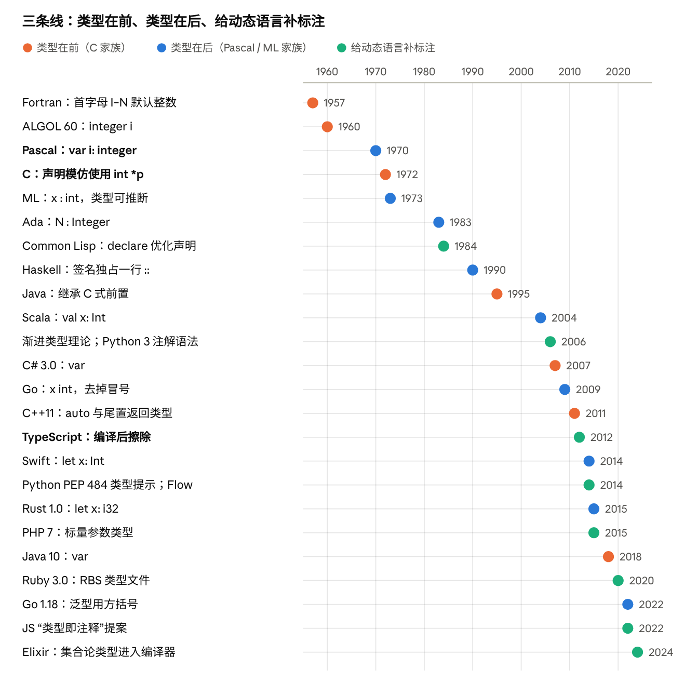

# 类型标注：风格与历史脉络

Oct 28, 2026 · @Jon Chen

这份调研比较各种编程语言“把类型写在哪里、怎么写”，并梳理这些写法的来历，作为设计新语言的参考。结论先放在前面：

- **主流已经收敛到“名字在前、类型在后”。** 2000 年以后新设计的主流语言（Scala、Go、Rust、Swift、Kotlin、TypeScript、Zig、Python 的类型提示）几乎都把类型放在名字后面，只有 C 家族的直系后代（Java、C#、Dart）保留前置。推动收敛的主要是**类型推断**：类型在后，省略时只是少写一段 `: T`，语法不用变。
- **这条路的源头很早。** Pascal（1970）和 ML（1970 年代）就用 `x : T`；C（1972）走了“声明模仿使用”的另一条路，影响了之后三十年的工业语言，也留下了解析上的麻烦。
- **第三条线是给动态语言“补”类型。** Lisp 的 `declare`、Python 的类型提示、TypeScript、Ruby 的 RBS、Elixir 的集合论类型，核心问题都一样：标注写在代码里还是另一个文件里，运行时管不管它。
- **标注风格影响的不只是好看。** 它决定了解析器的难度（C 的声明歧义、泛型尖括号和小于号的冲突）、长类型下的可读性、补全和重构工具的体验，以及推断能不能自然地接进来。

本文的代码示例按各语言的常见写法整理，没有逐一编译；年份和状态类的事实标了来源。

## 一张总表

同一件事在各语言里的写法：声明一个整数变量 `n`，以及一个函数 `rep`，接收一个字符串和一个整数，返回字符串。

| 语言 | 变量 | 函数签名 | 风格 |
| --- | --- | --- | --- |
| Fortran 77 | `INTEGER N`（不写也行：I–N 开头默认是整数） | `CHARACTER*(*) FUNCTION REP(S, N)` | 前置；隐式类型 |
| C | `int n = 0;` | `char *rep(const char *s, int n);` | 前置；声明模仿使用 |
| C++11 | `auto n = 0;` | `auto rep(std::string s, int n) -> std::string;` | 前置，但可以尾置返回类型 |
| Java / Dart | `int n = 0;`（Java 10 起也可 `var`） | `String rep(String s, int n)` | 前置 |
| C# | `var n = 0;` | `string Rep(string s, int n)` | 前置 |
| Visual Basic | `Dim n As Integer` | `Function Rep(s As String, n As Integer) As String` | 后置，关键字 `As` |
| Pascal | `var n: Integer;` | `function Rep(s: string; n: Integer): string;` | 后置，冒号 |
| Ada | `N : Integer := 0;` | `function Rep (S : String; N : Integer) return String;` | 后置，冒号；返回用 `return` |
| Go | `var n int = 0` | `func rep(s string, n int) string` | 后置，无分隔符 |
| Zig | `var n: i32 = 0;` | `fn rep(s: []const u8, n: usize) []u8` | 后置；返回类型无箭头 |
| Rust | `let n: i32 = 0;` | `fn rep(s: &str, n: usize) -> String` | 后置，`->` 返回 |
| Swift | `let n: Int = 0` | `func rep(_ s: String, _ n: Int) -> String` | 后置，`->` 返回 |
| Kotlin / Scala | `val n: Int = 0` | `fun rep(s: String, n: Int): String` | 后置，冒号返回 |
| TypeScript | `let n: number = 0` | `function rep(s: string, n: number): string` | 后置，冒号返回；编译后擦除 |
| Python | `n: int = 0` | `def rep(s: str, n: int) -> str:` | 后置；运行时不检查 |
| PHP 7+ | — | `function rep(string $s, int $n): string` | 参数前置、返回后置；运行时检查 |
| Julia | `n::Int = 0` | `function rep(s::String, n::Int)::String` | 双冒号；参与多重分派 |
| OCaml | `let n : int = 0` | `val rep : string -> int -> string`（写在 .mli） | 冒号；签名可以放另一个文件 |
| Haskell | `n :: Int` | `rep :: String -> Int -> String` | 签名单独一行，双冒号 |
| Lean / Idris | `def n : Nat := 0` | `def rep (s : String) (n : Nat) : String` | 冒号；类型与值同一套语言 |
| Common Lisp | `(declaim (fixnum *n*))` | `(declaim (ftype (function (string fixnum) string) rep))` | 单独的声明形式；为优化服务 |
| Typed Racket | `(: n Integer)` | `(: rep (-> String Integer String))` | 签名单独一行 |
| Clojure | — | `(defn rep ^String [^String s ^long n] …)` | 元数据提示，只为避免反射 |
| Erlang | — | `-spec rep(string(), integer()) -> string().` | 签名单独一行，供 Dialyzer 使用 |
| Elixir | — | `@spec rep(String.t(), integer()) :: String.t()` | 模块属性；编译器另有推断 |
| Ruby（RBS） | — | `def rep: (String s, Integer n) -> String`（写在 .rbs） | 另一个文件，或写成注释 |
| Ruby（Sorbet） | — | `sig { params(s: String, n: Integer).returns(String) }` | 普通 Ruby 代码当签名 |

大致可以归成六类：

1. **前置**：`int n`。C、Java、C#、Dart。
2. **后置加冒号**：`n: Int`。Pascal、ML、Scala、Rust、Swift、Kotlin、TypeScript、Python、Zig、Lean。
3. **后置不加分隔符**：`n int`。Go 把 Pascal 式的“x: int”去掉了冒号。
4. **后置加关键字**：`n As Integer`。BASIC 家族。
5. **签名单独一行**：`rep :: String -> Int -> String`。Haskell、Elm、Typed Racket、Erlang、Elixir 的 `@spec`。
6. **写在别处**：另一个文件（OCaml 的 .mli、TypeScript 的 .d.ts、Ruby 的 .rbs、Python 的 .pyi）、注释（JSDoc、rbs-inline），或者干脆由名字决定（Fortran 的首字母规则、BASIC 的 `A$`、Perl 的 `$ @ %`）。

## 设计维度

“类型标注风格”可以拆成八个独立的选择。设计新语言时，逐项回答即可。

| 维度 | 常见选项 | 代表 |
| --- | --- | --- |
| 1. 位置 | 类型在前 `int n` / 类型在后 `n: Int` / 单独一行 / 另一个文件 | C、Java / Rust、TS / Haskell / OCaml .mli、.d.ts、.rbs |
| 2. 分隔符 | 无 / `:` / `::` / 关键字 `As` | Go / Pascal、ML / Haskell、Julia / BASIC |
| 3. 返回类型 | 前置 / `: T` / `-> T` / 直接跟在参数后 / `return T` | C / Kotlin、TS / Rust、Swift、Python / Go、Zig / Ada |
| 4. 泛型写法 | `List<T>` / `List[T]` / `List T`（前缀应用）/ `T list`（后缀应用） | C++、Java、Rust / Scala、Go、Python / Haskell / OCaml |
| 5. 复合类型 | 指针、数组、可空写在哪一侧：`int *p`、`[3]int`、`int[] a`、`T?` | C / Go / Java / Kotlin、Swift、C# |
| 6. 省略程度 | 必须写 / 局部推断（变量可省，函数边界要写）/ 全局推断（几乎都可省） | 早期 Java / Rust、Go、Kotlin、Swift / ML、Haskell |
| 7. 写在哪里 | 代码里 / 注释里 / 单独的接口文件 | 多数 / JSDoc、rbs-inline / .mli、.d.ts、.pyi、.rbs |
| 8. 运行时含义 | 静态检查后擦除 / 运行时也检查 / 参与分派 / 只是优化提示 / 完全不管 | TS、Python、大部分静态语言 / PHP、Typed Racket 边界 / Julia / Common Lisp、Clojure / Python 解释器本身 |

几个维度之间有联动：

- **位置和省略程度。** 类型在后，推断只是“不写 `: T`”；类型在前，推断就要另造一个占位关键字，于是有了 C++ 的 `auto`、C# 和 Java 的 `var`。
- **分隔符和其他语法。** 冒号在很多语言里已经有用途：在 Haskell 里 `:` 是列表的“构造”运算符，所以类型标注只好用 `::`；ML 家族正好相反，列表构造是 `::`，类型标注是 `:`。Python 的冒号本来只用在代码块开头和字典里。
- **泛型括号和表达式语法。** `<` 同时是小于号，`a < b > (c)` 既可以是比较，也可以是泛型调用，这是 Go 最终选了方括号、Rust 引入 `::<>`（“涊轮鱼”语法）的原因，详见后文“语法与解析的代价”。
- **写在哪里和运行时含义。** 标注只用于静态检查的语言，可以把它们从代码里搬走（TypeScript 的 .d.ts、Ruby 的 .rbs）；一旦类型参与运行时行为（Julia 的多重分派、PHP 的参数检查），它就必须留在代码里。

## 历史脉络一：类型在前

下图把三条历史线索放在一起，后面三节分别展开。



**Fortran：类型由名字决定。** 1957 年的 Fortran 里，不声明的变量按首字母定类型：I 到 N 开头是整数，其他是浮点数，沿用了数学里用 i、j、k、n 表示下标的习惯。需要时可以写 `INTEGER X` 覆盖。拼错变量名会静默地创建一个新变量，所以后来广泛推荐 `IMPLICIT NONE`（Fortran 90 正式标准化）。“名字里带类型”的思路后来也出现在 BASIC 的 `A$`、Perl 的 `$ @ %` 和匈牙利命名法里。

**ALGOL：类型写在前面。** ALGOL 60 用 `integer i; real array a[1:10]` 这样的前置声明，影响了后来的 CPL、BCPL 和 C。ALGOL 68 又提出了一套由基本类型组合成数组、指针、函数的类型结构。

**C：声明模仿使用。** C 的前身 B 和 BCPL 是无类型的，只有“机器字”一种数据。Ritchie 在《The Development of the C Language》里说，C 的类型组合方式“很大程度受惠于 ALGOL 68”，而声明语法的原则是“变量的声明长得像它在表达式里的用法”：`int *p` 的意思是“`*p` 是一个 int”，`int a[3]` 的意思是“`a[i]` 是一个 int”。这个原则很统一，但代价是声明要“由内向外”读。函数指针 `int (*fp)(int, int)` 已经不好读，再返回一个函数指针就更难，于是有了专门翻译声明的工具 cdecl。Ritchie 引用 Sethi 的意见承认，如果解引用 `*` 当初是后缀运算符，嵌套声明会简单得多，但已经太晚了；他仍认为这套做法“依然说得通”。另一个常见的坑：`int* x, y;` 里只有 x 是指针。

**C++、Java、C#：继承并打补丁。** C++ 和 Java 继承了前置风格；Java 把数组的方括号移到了类型这边（`int[] a`），算是离开“声明模仿使用”的一步。类型推断出现后，前置风格只好用占位词补上：C# 3.0（2007）的 `var`、C++11（2011）的 `auto`、Java 10（2018）的 `var`。C++11 还引入了尾置返回类型 `auto f(T x) -> R`，主要是为了让返回类型能引用参数（配合 `decltype`），客观上也让 C++ 向“类型在后”靠拢了一点。

这条线的经验是：前置风格对简单类型很紧凑，但对复合类型、类型推断和解析都不友好，后来的版本一直在打补丁。

## 历史脉络二：类型在后

**Pascal 家族。** Wirth 的 Pascal（1970）写 `var i: integer`，函数写 `function f(x: real): real`。这个写法被 Modula-2、Oberon、Ada（1983）和 Delphi 继承。它的好处是从左到右读：“i 是一个整数”，复合类型也写成一个独立的短语，比如 `array[1..10] of integer`、`^Node`。Go 的声明写法就是从这里来的，Rob Pike 在 2010 年的博客《Go's Declaration Syntax》里解释：名字在前、类型在后，函数类型就能从左到右读下来，如 `f func(func(int, int) int, int) int`；并把通常的冒号也省了。

**ML 家族：标注变成可选。** Milner 的 ML（1970 年代，为 LCF 定理证明器设计）引入了 Hindley–Milner 类型推断，绝大多数类型都可以不写。于是“类型标注”从声明的一部分，变成了一个独立的、可以加在任何表达式上的小语法 `(e : t)`，叫类型归属（ascription）。后置加冒号在这里最自然：写不写都不影响其他语法。ML 家族还把类型构造写成后缀：`int list`、`string option`。OCaml 另有 .mli 接口文件，把签名和实现分开。

**Haskell：签名独占一行。** Haskell（1990）把函数的类型写成单独的一行 `f :: Int -> Int`，紧挨着定义。参数名只出现在定义里，类型只出现在签名里，两者互不干扰，这很适合柯里化和模式匹配的多子句定义。《A History of Haskell》提到，用 `:` 表示列表构造、用 `::` 表示类型签名“当时争议很大”，而且 ML 正好相反；Haskell 的列表构造继承自 Miranda 等前辈。Elm、PureScript、Idris（用单冒号）、Typed Racket、Erlang 的 `-spec` 都采用了“签名单独一行”的形式。

**现代收敛。** 2000 年以后的新语言几乎一边倒：

| 语言 | 年份 | 写法 | 来源与特点 |
| --- | --- | --- | --- |
| ActionScript 3 / ECMAScript 4 草案 | 2000 年代 | `var x:int` | 给 JavaScript 加类型的第一次尝试；TypeScript 采用了相同的写法 |
| Scala | 2004 | `val x: Int`、`def f(x: Int): Int` | 结合 ML 的推断与 Java 生态 |
| Go | 2009 | `var x int`、`func f(x int) int` | Pascal 风格去掉冒号 |
| TypeScript | 2012 | `let x: number` | JS 的超集，标注在编译后擦除 |
| Swift | 2014 | `let x: Int`、`func f(_ x: Int) -> Int` | `->` 返回，另有参数标签 |
| Rust | 2015（1.0） | `let x: i32`、`fn f(x: i32) -> i32` | 函数边界必须写，函数内部局部推断 |
| Kotlin | 2016（1.0） | `val x: Int`、`fun f(x: Int): Int` | 为取代 Java 而设计，却没有沿用 Java 的前置 |
| Python 3 | 2006 起 | `def f(x: int) -> int`、`x: int = 0` | 函数注解（PEP 3107）、变量注解（PEP 526） |

为什么收敛到这里，主要有四个原因：

1. **类型推断成为标配。** 后置写法里，省略类型只是少写 `: T`，`let x = 1` 和 `let x: i32 = 1` 是同一个语法；前置写法就得另加 `auto` 或 `var`。
2. **名字比类型重要。** 读代码时先找的是名字；类型越长（泛型、函数类型），名字在前的优势越明显。
3. **解析更简单。** 先看到关键字 `let` / `val` / `fn`，解析器就知道接下来是声明，不用像 C 那样先判断一个名字是不是类型。
4. **和动态语言兼容。** 在 Python、JavaScript 里加类型时，把 `: T` 加在后面不会打乱原有的 `x = 1` 和 `def f(x)`。

## 历史脉络三：给动态语言补标注

动态语言加类型时，约束最多：不能破坏已有代码，不能拖慢运行时，还要允许只给一部分代码加类型。各家给出的答案可以按“标注的含义”分成四类。

**一、给编译器的优化提示。** Common Lisp（CLtL，1984）用 `(declare (fixnum x))` 和 `(the fixnum e)` 告诉编译器可以生成更快的代码，是否检查由实现和优化级别决定。Clojure 的 `^String` 只用来避免 JVM 反射调用。这类标注通常是单独的声明形式或元数据，而不是语法的一部分。

**二、给外部检查器，运行时忽略。**

- **渐进类型理论**：Siek 与 Taha（2006）提出用一个“未知”类型（常写成 `?` 或 `any`/`Any`）把静态和动态代码接起来，是后面几乎所有方案的理论基础。
- **Python**：PEP 3107（2006，Python 3.0）只提供了函数注解的语法，刻意不规定含义；mypy 先行实验后，PEP 484（2014 年提出，Python 3.5）才把它定为类型提示；PEP 526（Python 3.6）加上了变量注解；PEP 695（Python 3.12）加上了 `def f[T](x: T)` 的泛型语法。解释器至今不检查这些标注。先有语法、后有语义、再由社区检查器竞争，是一种很少见的做法。
- **TypeScript（Microsoft，2012）和 Flow（Facebook，2014）**：编译时检查，输出的 JavaScript 里擦掉所有类型。类型可以写在代码里，也可以单独写在 .d.ts 里给纯 JS 库用，还可以写在 JSDoc 注释里。
- **JavaScript 的“类型即注释”提案**：TC39 的 Type Annotations 提案（2022 年起，目前仍在 Stage 1）让引擎直接跳过 `let x: string` 这样的标注，把它们当注释，以便 TypeScript 代码不经编译就能运行。
- **Ruby**：Ruby 3.0（2020）引入 RBS，类型写在单独的 .rbs 文件里；Stripe 的 Sorbet 用普通 Ruby 代码写签名 `sig { params(name: String).returns(String) }`。Shopify 2025 年的文章提到，开发者觉得 `sig` 太啰嗦，调查里近 75% 的人希望更易读的语法，于是 Sorbet 开始支持写在注释里的 RBS：`#: (String) -> String`。Ruby 就这样在“另一个文件”“代码里的 DSL”“注释”三种位置之间走了一圈。
- **Erlang**：`-spec` 属性供 Dialyzer 做“成功类型”分析，只报告一定会出错的地方。

**三、运行时也生效。** PHP 7（2015）的参数与返回类型在运行时检查，可以用 `declare(strict_types=1)` 关掉自动转换；Typed Racket（2008 年前后）在类型化代码和未类型化代码的边界插入契约检查。这样更安全，但代价是运行时开销，而且标注必须留在代码里。

**四、参与语义。** Julia 的 `x::Int` 既是断言，又是多重分派的依据：同名函数按参数类型选择实现。标注不是为了安全，而是为了表达“哪个方法管哪些类型”；性能主要靠对具体类型的编译，而不是靠标注。

**完全不写的变体。** Elixir 走了另一条路：先在不引入任何标注的前提下，用集合论类型对已有程序做推断和渐进检查。2026 年 6 月的 Elixir 1.20 宣布完成了这一阶段，用户写的类型签名还在后面的计划里。先推断、后标注，是和 Python 相反的顺序。

**小结。** 在动态语言里，几乎所有新方案都选了后置 `: T`（Python、TypeScript、Flow、Luau、JS 提案），因为它可以插在已有语法里而不改变其他东西；真正的分歧在于“写在哪里”和“运行时管不管”。

## 语法与解析的代价

标注风格最硬的代价不在审美，而在解析器和工具。下面是几个有名的坑。

**C 的“这是不是类型”问题。** 在 C 里，`T * x;` 既可能是“声明一个指向 T 的指针 x”，也可能是“T 乘以 x”，取决于 T 是不是用 typedef 定义的类型名。`(T)(x)` 也一样，可能是强制转换，可能是函数调用。所以 C 编译器的词法分析需要查符号表，俗称“lexer hack”。C++ 还有“最令人烦恼的解析”：`Foo bar(Baz());` 被解析成一个函数声明，而不是用临时对象初始化变量。根源都是：声明没有引导关键字，只能靠“开头是不是类型”来判断。

**泛型尖括号和小于号。** 表达式里的 `<` 很难判断是比较还是泛型参数：

- **Go**：官方 FAQ 用 `a, b = w < x, y > (z)` 说明，它既可以是两个比较，也可以是一次泛型调用。由于“不需要类型信息就能解析”是 Go 的关键设计决定，Go 1.18（2022）的泛型最终用了方括号：`func Map[T, U any](xs []T, f func(T) U) []U`。
- **Rust**：表达式里的泛型参数必须写成 `parse::<i32>()`，即“涊轮鱼”。Rust 的测试集里有一个叫“涊轮鱼堡垒”的用例，用 `(the<guardian, stands>(resolute))` 说明去掉 `::` 会产生歧义。
- **C++**：需要 `template` 和 `typename` 关键字帮解析器消歧；`>>` 直到 C++11 才允许写成 `vector<vector<int>>`。
- **TypeScript**：在 .tsx 里 `<T>` 和 JSX 标签冲突，所以类型断言改用 `x as T`，泛型箭头函数有时要写成 `<T,>`。
- Scala、Python、Go、Nim 用 `[]` 表示泛型；Haskell、ML 用空格表示类型应用（`Maybe Int`、`int option`），完全绕开了括号。

**冒号和其他语法的冲突。** Haskell 把 `:` 留给了列表，类型只好用 `::`；C++ 的 `::` 是作用域运算符，Julia 的 `::` 是类型断言；Python 的冒号本来表示代码块开始，所以 lambda 至今不能写参数标注。设计早期就要想好“冒号归谁”。

**标注求值的时机。** 如果标注是普通表达式（Python），就会碰到“引用还没定义的类”的问题，只好写成字符串 `"Node"`。Python 为此折腾了多年，直到 3.14 采用 PEP 649：标注在定义时不再求值，只在被读取时才求值，前向引用不用再加引号。

**可读性与工具。**

- 名字在前时，一组声明的名字左对齐，容易扫读；类型很长时不会把名字推到行尾。
- 类型在前时，IDE 可以在你写完类型后建议变量名（Java IDE 的常见功能）；名字在前时，写完名字和冒号后可以补全类型。两者各有所长。
- 签名单独一行（Haskell）时，参数名和类型分在两处，参数多时要在两行之间来回对照。

## 给新语言的设计建议

按上面的八个维度，给出一份决策清单。这是根据各语言的经验整理的倾向，不是唯一答案。

| 问题 | 默认建议 | 理由 | 例外 |
| --- | --- | --- | --- |
| 类型在前还是在后？ | 在后 | 与推断自然结合；名字对齐；解析不需要符号表 | 要求和 C 家族紧密互通时 |
| 声明有没有引导关键字？ | 有：`let` / `var` / `fn` | 解析器第一个词就知道是声明；避免 C 的 lexer hack | — |
| 分隔符用什么？ | `:` | 最广泛的共识，对迁移过来的程序员最友好 | 冒号已被占用时用 `::`；想极简可以学 Go 不写 |
| 返回类型怎么写？ | `-> T` 或 `: T`，保持与函数类型写法一致 | 函数类型 `(A, B) -> C` 和签名长得一样，少一套规则 | — |
| 泛型用什么括号？ | `[T]` 或空格应用 | 避开小于号歧义，不需要涊轮鱼 | 数组下标已用 `[]` 时，要想清楚怎么区分 |
| 复合类型修饰符放哪边？ | 全部前置，从左到右读：`?T`、`[]T`、`*T`，或全部后置 | 避免 C 那样“由内向外”读 | — |
| 哪里必须写类型？ | 模块导出的函数边界必须写，局部变量可省 | Rust、Go、Swift 的共识：签名即文档，报错也更局部 | 脚本语言可以全部可省 |
| 类型写在代码里还是别处？ | 代码里，另外允许生成接口文件 | 单独文件容易和实现脱节；Ruby 社区的经验是最终又回到代码旁边 | 给已有动态语言加类型时，另写文件是平滑过渡手段 |
| 运行时管不管？ | 静态检查，在动态边界处插入检查 | 只擦除会让类型“说谎”，全检查太慢 | 类型参与分派时（Julia），必须留在运行时 |
| 标注是表达式还是独立语言？ | 独立的类型语法，延迟求值 | 避开 Python 的前向引用问题 | 依赖类型语言（Lean、Idris）类型就是表达式 |

一个最小的参考方案可以是：

```
let n = 0                          // 推断
let m: Int = 0                     // 归属，可选
fn rep(s: String, n: Int) -> String
fn map[T, U](xs: List[T], f: (T) -> U) -> List[U]
let name: ?String = none           // 修饰符前置，从左到右读
```

如果设计的是 Lisp 风格或结构化编辑的语言，经验另有不同：类型通常以单独的声明形式或元数据出现（Typed Racket 的 `(: f (-> A B))`、Clojure 的 `^T`、Common Lisp 的 `declare`），不存在解析歧义，取舍主要在于“签名单独一行”还是“贴在参数上”，以及编辑器能否把类型显示在名字旁边。

## 参考资料

- Dennis Ritchie：[The Development of the C Language](https://www.cs.tufts.edu/~nr/cs257/archive/dennis-ritchie/chist.pdf)（声明模仿使用、受 ALGOL 68 影响、B 与 BCPL 无类型）
- Rob Pike：[Go's Declaration Syntax](https://go.dev/blog/declaration-syntax)（2010）
- Go 网站仓库中的 FAQ 提交：[为什么泛型不用 F\<T>](https://go.googlesource.com/website/+/f22c23a0f3fe0beae558022ebe020fc114cec285%5E%21/)
- Ben Hoyt：[Name before type](https://benhoyt.com/writings/name-before-type/)（2023）
- Hudak 等：[A History of Haskell: Being Lazy with Class](https://www.cse.sc.edu/~mgv/csce590f20/haskell/historyOfHaskell2007.pdf)（2007，`:` 与 `::` 的争议）
- Rust 测试用例：[bastion-of-the-turbofish.rs](https://rust.googlesource.com/rust/+/HEAD/tests/ui/parser/bastion-of-the-turbofish.rs)
- [What's new in Python 3.14](https://docs.python.org/de/3/whatsnew/3.14.html)（PEP 649 / 749 延迟求值）
- TC39：[Type Annotations 提案](https://github.com/tc39/proposal-type-annotations/)
- Shopify：[RBS support for Sorbet](https://railsatscale.com/2025-04-23-rbs-support-for-sorbet/)（2025）
- [Elixir v1.20 released](https://elixir-lang.org/blog/2026/06/03/elixir-v1-20-0-released)（2026）
- [Fortran 声明与隐式类型](https://learning.rc.virginia.edu/courses/fortran-introduction/declarations/)（弗吉尼亚大学课程讲义）

未逐篇核对、依据常见资料整理的条目：Pascal、ML、Ada、Common Lisp、ActionScript 3 的年份与写法；Siek 与 Taha 的渐进类型（2006）；Python 各 PEP 的年份；PHP 7、Typed Racket、Julia、Luau 的类型语义；C++ 的 most vexing parse 与 `>>`；TypeScript 在 .tsx 里的泛型写法。各语言代码示例未逐一编译。
