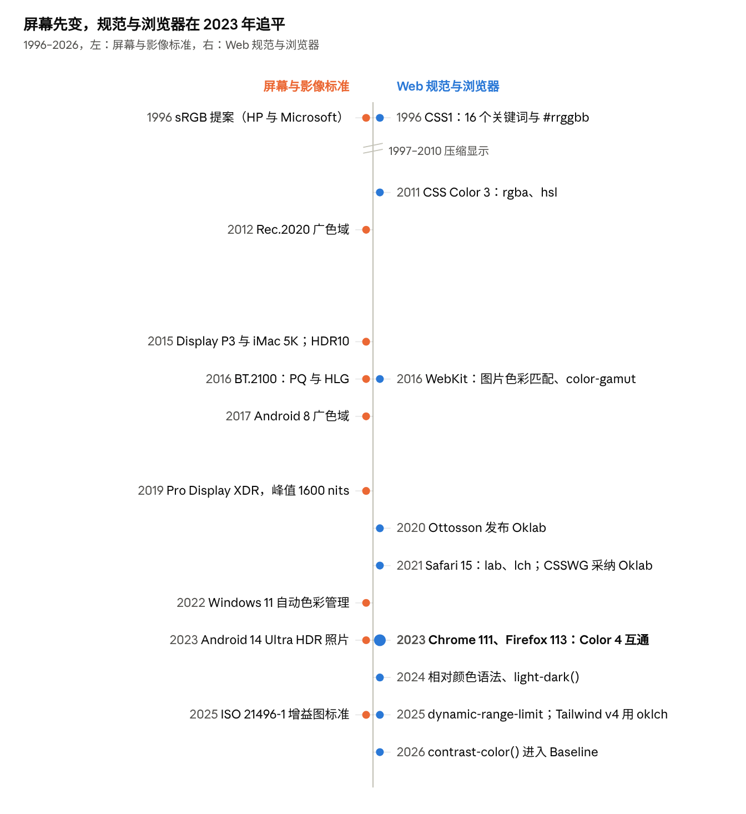

# Web 平台的颜色：屏幕、规范与设备

Oct 28, 2026 · @Jon Chen

## 结论先行

Web 的颜色在 2016–2025 年间从“只有 sRGB”变成了“与设备无关的色彩空间 + 广色域 + 开始支持 HDR”。驱动力是硬件先变、规范和浏览器追赶：Apple 在 2015–2016 年把 Mac 和 iPhone 换成 Display P3 屏幕，CSS 当时却规定颜色只在 sRGB 里（WebKit 博客原话），于是 WebKit 先动手。

- **三次跳变。** 1996 年的 sRGB 让网页颜色第一次有了明确含义；2023 年 5 月三大浏览器都支持 CSS Color 4（lab、lch、oklab、oklch、color()），广色域成为 Baseline；2025 年起 `dynamic-range-limit`、HDR 图片（ISO 21496-1 增益图）和 WebGPU HDR 画布让 HDR 走进网页。
- **表示方式的转向。** 从“给显示器的三个 0–255 数字”变成“指明色彩空间的坐标”。`#ff0000` 和 `color(display-p3 1 0 0)` 是两种红，后者在 P3 屏上更饱和。
- **感知均匀成了默认。** 2021 年 CSSWG 决定用 Oklab 做非传统颜色的默认插值空间、用 OKLCH 做色域映射；它来自游戏开发者 Björn Ottosson 2020 年底的一篇博客。Tailwind CSS v4（2025-01）把整套默认调色板换成了 oklch。
- **推动者是一个小圈子。** W3C 的 Chris Lilley、规范编辑 Lea Verou 与 Tab Atkins、Chrome 的 Christopher Cameron、WebKit 团队，加上 BBC、Dolby、Adobe、Google Android 这些影像标准方；设计工具（Sketch、Figma）和 CSS 框架把成果带给大量开发者。
- **还没解决的。** 色域映射算法仍在讨论（浏览器长期直接裁剪）；WCAG 3 的对比度算法未定；Firefox 默认仍不对未标注内容做色彩管理；WebXR 规范里只有 sRGB，没有广色域或 HDR。



左边的硬件与影像标准在 2015–2017 年密集变化，右边的 CSS 直到 2021–2023 年才集中跟上；HDR 则在 2025 年前后同时出现在两边。

## 屏幕特性

一块屏幕能显示什么颜色，由四件事决定：三个原色的位置（色域）、白点、传递曲线（数值怎么变成亮度）、以及亮度范围和位深。网页上的一个颜色值，只有说清楚是哪个空间里的坐标，系统才能把它换算到这块屏幕上。

**人眼与参照系。** CIE 1931 根据 1920 年代 Wright 与 Guild 的配色实验定义了 XYZ，是与设备无关的参照。xy 色度图里两种光的混合落在连线上，所以三原色屏幕的色域是一个三角形。xy 不是感知均匀的，1976 年的 CIELAB 试图修正，2020 年的 Oklab 又修正了 CIELAB 在蓝色区的色相偏移。

| 色彩空间 | 年份 | 定义者 | 原色 / 传递曲线 | 占 CIE 1931 xy 面积 |
| --- | --- | --- | --- | --- |
| sRGB | 1996（IEC 61966-2-1:1999） | HP 与 Microsoft | BT.709 原色、D65；分段曲线，约等于 gamma 2.2；参考亮度 80 cd/m² | 35.9% |
| Display P3 | 2015 | Apple | DCI-P3 原色 + D65 + sRGB 曲线 | 53.6%（DCI-P3） |
| Rec.2020 | 2012 | ITU-R | 630 / 532 / 467 nm 单色原色；10 或 12 位 | 75.8% |
| Rec.2100 | 2016 | ITU-R | Rec.2020 原色 + PQ（SMPTE ST 2084）或 HLG 两种 HDR 曲线 | 同 Rec.2020 |

- **sRGB 的来历。** 1996 年 11 月，HP 的 Michael Stokes、Ricardo Motta 和 Microsoft 的 Matthew Anderson、Srinivasan Chandrasekar 向 W3C 提交《A Standard Default Color Space for the Internet》。它把当时 CRT 显示器的平均特性写成了标准，所以是“不带配置文件时的默认假设”。
- **位深。** 8 位是每通道 256 级，10 位是 1024 级。色域越大、亮度范围越大，相邻两级的差距越大，渐变就越容易出现色带；不少面板用 FRC（在两级之间快速切换）模拟 10 位。
- **HDR 与亮度。** ITU-R BT.2408 把 HDR 里的“参考白”定在 203 cd/m²。Apple 的 EDR 把 SDR 白记为 1.0，超出 1.0 的部分叫“余量”（headroom）：iPhone XDR 约 8 倍，iPad Pro XDR 约 16 倍，Pro Display XDR（2019，峰值 1600 nits）在低亮度下可达约 400 倍。余量随环境和亮度设置变化，这是 HDR 在网页里难处理的根源。
- **面板技术。** 2015 年前后量子点电视、HDR10 标准和 Apple 全线 P3 几乎同时出现；2021 年 iPad Pro 的 mini-LED（2596 个调光区，峰值 1600 nits）和 OLED 手机让 HDR 进入普通用户手里。
- **系统色彩管理。** WebKit 从 OS X 10.11.3 / iOS 9.3 起对带配置文件的图片做色彩匹配，未标注内容当作 sRGB；Android 8.0（2017）让应用按 Activity 声明 `wideColorGamut`；Windows 11 22H2 的自动色彩管理把桌面合成器改为 FP16，把不认识色彩的应用从 sRGB 映射到屏幕色域。

一个常见误解：Apple 说 P3 “饱和度高 25%”，是和 iPad Air 2 的比较，不是色域面积。按 xy 面积算，DCI-P3 约为 sRGB 的 1.5 倍。

## CSS 颜色规范的变迁

CSS 颜色经历了四代：关键词和十六进制（CSS1）、更便于人写的 sRGB 写法（Color 3）、与设备无关的色彩空间（Color 4）、颜色运算与 HDR（Color 5 和 Color HDR）。前三代的所有写法都只是 sRGB 的不同拼法。

| 规范 | 状态与年份 | 新增 | 备注 |
| --- | --- | --- | --- |
| CSS1 | 1996 | 16 个基本关键词、`#rgb` / `#rrggbb`、`rgb()` | 关键词来自 HTML；CSS2 加了 `orange` |
| CSS2 | 1998 | 28 个系统颜色（`ButtonFace`、`WindowText` 等） | Color 3 废弃了它们，后来以 CSS system colors 的形式保留一部分 |
| CSS Color 3 | 2011 REC | `rgba()`、`hsl()`、`hsla()`、`transparent`、`currentColor`、147 个 X11 命名色 | 明确“RGB 即 sRGB”；X11 名字里 `darkgray` 比 `gray` 还浅 |
| CSS Color 4 | 2022 CR | `lab()`、`lch()`、`oklab()`、`oklch()`、`hwb()`、`color()`、`none`、空格语法、`rebeccapurple` | `color()` 的预定义空间：srgb、srgb-linear、display-p3、a98-rgb、prophoto-rgb、rec2020、xyz-d50、xyz-d65；规定色域映射 |
| CSS Color 5 | 工作草案（2026-06） | `color-mix()`、相对颜色语法 `from`、`light-dark()`、`contrast-color()`、`device-cmyk()`、`@color-profile` | `color-mix()` 不指定空间时默认 Oklab |
| CSS Color HDR 1 | 工作草案（2024-12 起） | `dynamic-range-limit`、`hdr-color()`、`ictcp()`、`jzazbz()`、rec2100-pq / hlg / linear | 编辑 Chris Lilley；HDR 参考白 203 cd/m² |

同一个“红”在各代规范里的写法：

```css
/* CSS1：关键词与十六进制，都是 sRGB */
color: red;  color: #f00;  color: rgb(255, 0, 0);

/* Color 3：透明度与 HSL，仍是 sRGB */
color: rgba(255, 0, 0, .5);  color: hsl(0 100% 50%);

/* Color 4：指明色彩空间，可以超出 sRGB */
color: color(display-p3 1 0 0);      /* P3 屏上更饱和的红 */
color: oklch(62.8% 0.258 29.2);      /* 亮度 / 色度 / 色相 */
color: lab(54.3% 80.8 69.9);

/* Color 5：由已有颜色算出新颜色 */
color: color-mix(in oklab, red 60%, white);
color: oklch(from var(--brand) calc(l + .1) c h);
color: light-dark(#222, #eee);
color: contrast-color(var(--bg));    /* 黑或白 */

/* HDR：限制页面里 HDR 内容的亮度 */
img { dynamic-range-limit: standard; }

/* 按屏幕能力分支 */
@media (color-gamut: p3) { … }
@media (dynamic-range: high) { … }
```

**为什么要 OKLCH。** HSL 的“亮度 50%”对黄色和蓝色看起来完全不同；sRGB 里蓝到白的渐变会发紫。Oklab 的目标是等距离就是等感知差距，所以改亮度不会带动色相，生成调色板和渐变更稳定。2021 年 9 月 Chris Lilley 开了 CSSWG issue #6642，10 月 13 日工作组决议加入 `oklab()` / `oklch()`，并把 Oklab 定为非传统颜色的默认插值空间。

**色域映射的争论。** 一个 oklch 颜色可能超出屏幕色域。规范描述了裁剪、降低色度等做法，但浏览器一开始都直接逐通道裁剪，色相会变。issue #9449（2023）批评这“破坏了 oklch 的意义”；2024 年 Chrome 的 Christopher Cameron 开 #10579 比较更快的静态映射算法，讨论仍在继续。

## 各种颜色表示的差异

这些写法的差别在三件事：坐标轴指什么、能不能超出 sRGB、坐标上的等距是不是看起来的等距。前三种只是 sRGB 的换写，`lab` / `oklab` 系与设备无关，`color()` 是“指明哪个 RGB 空间”。

| 写法 | 三个坐标 | 能表示的范围 | 感知均匀 | 常见坑 |
| --- | --- | --- | --- | --- |
| `#rrggbb`、`rgb()` | 红、绿、蓝的编码值 0–255 | 只有 sRGB | 否 | 数值是伽马编码后的，不是光强；数值的中点不是亮度的中点 |
| `hsl()` | 色相角、饱和度、“亮度” | 只有 sRGB | 否 | 亮度 50% 的黄色和蓝色看起来差很远（OKLCH 亮度 0.97 对 0.45） |
| `hwb()` | 色相、混入的白、混入的黑 | 只有 sRGB | 否 | 类似取色器的想法，问题同 HSL |
| `lab()`、`lch()` | 亮度 L 0–100，a/b 或色度/色相；D50 白点 | 所有可见色 | 大体 | 蓝紫区改变亮度或色度时色相会漂（蓝变紫） |
| `oklab()`、`oklch()` | 亮度 L 0–1，色度 C（实用上限约 0.37），色相 H；D65 | 所有可见色 | 更好 | 同一亮度下不同色相的最大色度不同，很容易写出色域外的颜色 |
| `color(display-p3 …)` 等 | 指定空间里的 R G B，0–1 | 该空间的三角形 | 否 | 同样的数字在不同空间是不同的颜色 |

同一个颜色 `rebeccapurple` 的各种写法（由 sRGB 换算），以及一个 sRGB 写不出来的红：

```css
color: #663399;
color: rgb(102 51 153);
color: hsl(270 50% 40%);
color: hwb(270 20% 40%);
color: lab(32.39% 38.42 -47.69);
color: oklch(44.0% 0.160 303.4);
color: color(display-p3 0.374 0.210 0.579);   /* 同一个颜色，P3 坐标不同 */

/* P3 的最红：换到 sRGB 是 (1.093, -0.227, -0.150)，超出范围 */
color: color(display-p3 1 0 0);                /* oklch(64.9% 0.300 29.0) */
color: red;                                    /* oklch(62.8% 0.258 29.2) */
```

**插值也不同。** 同样从红到蓝，渐变在哪个空间里算，结果差很多：

```css
linear-gradient(in srgb,  red, blue)   /* 中间发暗、发灰的紫 */
linear-gradient(in oklab, red, blue)   /* 亮度平顺，中间是偏亮的紫 */
linear-gradient(in oklch, red, blue)   /* 沿色相环走，经过品红，饱和度不掉 */
linear-gradient(in oklch longer hue, red, blue)   /* 绕远路，经过黄和绿 */
```

- **旧写法保持旧行为。** Color 4 规定：只用 hex / rgb / hsl / hwb 等“传统”颜色的渐变和动画仍在 sRGB 里插值，只要有一端是新写法就默认用 Oklab。这是为了不改变已有网页的样子。
- **`none` 是“缺失”，不是 0。** `oklch(70% 0 none)` 没有色相，和彩色插值时用对方的色相，不会出现“灰向红插值时先变成别的颜色”。
- **精度。** 传统颜色按 8 位存储和序列化；新写法保留浮点，`getComputedStyle` 返回的仍是作者写的空间（如 `oklch(…)`），而不是换成 `rgb()`。
- **给设计系统的含义。** 在 OKLCH 里固定 C 和 H、只改 L，就能得到一组色相一致的深浅色；在 HSL 里做同样的事，深浅色的色相和感知亮度都会跑。Tailwind v4 和 Radix 的调色板就是这样生成的。

## 浏览器实现与色彩管理

Safari 先行、Chrome 和 Firefox 在 2023 年一起追平：Interop 2022 与 2023 都把“色彩空间与颜色函数”列为重点，2023 年 5 月 Lab / LCH / Oklab / OKLCH 在三大引擎互通。

| 特性 | Safari | Chrome / Edge | Firefox | Baseline |
| --- | --- | --- | --- | --- |
| `color-gamut` 媒体查询 | 10 | 58 | 110 | 2023 |
| `dynamic-range` 媒体查询 | 13.1 | 98 | 100 | 2022 |
| `lab()` `lch()` `color()` `hwb()` | 15（2021-10） | 111（2023-03） | 113（2023-05） | 2023-05 |
| `oklab()` `oklch()` | 15.4 | 111 | 113 | 2023-05 |
| `color-mix()` | 16.2（2022-12） | 111 | 113 | 2023-05 |
| 相对颜色语法 `from` | 18 | 119 | 128 | 2024 |
| `light-dark()` | 17.5 | 123 | 120 | 2024-05 |
| `contrast-color()` | 26 | 147 | 146 | 2026-04 |
| `dynamic-range-limit` | 26（不含 `constrained`） | 136（2025-04） | — | 未达 |

**色彩管理的历史比 CSS 语法更曲折。** 关键问题是“没有标注色彩空间的内容怎么办”：当作 sRGB 换算到屏幕，还是把数值直接交给屏幕。后者在广色域屏上会过饱和。

- **Firefox 3.5（2009）** 开始按配置文件校正带标注的图片（`gfx.color_management.mode` = 2），CSS 颜色和未标注图片仍用设备空间。这个默认值至今未变，bug 1488619 主张改为全管理，仍未关闭。
- **WebKit（2016）** 对所有图片做色彩匹配，未标注当作 sRGB，这是后来公认的做法。
- **Chrome** 在 macOS 上直到 2017 年仍把未标注图片和 CSS 颜色按显示器配置渲染，修复先放在 `--enable-color-correct-rendering` 后面；Chrome 94（2021）让 2D Canvas 完全按 sRGB 做色彩管理。

待核对：`color(display-p3)` 在 Safari 里确切的首个版本（2020 年 WebKit 博客说 macOS Mojave / iOS 11 起可用）；Chrome 全面色彩管理在各平台的版本。

## Canvas、WebGPU、图片与视频

像素接口比 CSS 更难升级，因为它们直接暴露数组：每个像素是哪个空间、各占几位，都要写进 API。

```js
// 2D Canvas：Chrome 94；Safari（macOS 12.1 / iOS 15.1）
const ctx = canvas.getContext('2d', { colorSpace: 'display-p3' });
ctx.fillStyle = 'color(display-p3 1 0 0)';
const img = ctx.getImageData(0, 0, w, h, { colorSpace: 'display-p3' });

// WebGL：Baseline 2024
gl.drawingBufferColorSpace = 'display-p3';

// WebGPU HDR：Chrome 129，允许超过 1.0 的值
context.configure({ device, format: 'rgba16float',
                    toneMapping: { mode: 'extended' } });

// 视频：解码前询问能力
navigator.mediaCapabilities.decodingInfo({ type: 'media-source',
  video: { contentType: 'video/mp4; codecs="hvc1"', width: 3840, height: 2160,
           bitrate: 2e7, framerate: 30,
           transferFunction: 'pq', colorGamut: 'rec2020', hdrMetadataType: 'smpteSt2086' } });
```

- **半精度浮点 Canvas。** Chrome 的 Cameron 在 2024 年 12 月提交 TAG 审查（2025 年 4 月获正面意见），Color on the Web CG 的草案用 `dataType: "float16"` 并增加 rec2100-pq / hlg 空间。发布状态待核对。
- **HDR 图片。** Google 与 Adobe 的增益图方案：一张普通 SDR JPEG 里附带一张“亮度增益图”，HDR 屏按余量放大，旧软件只看到 SDR。Android 14（2023）的 Ultra HDR、Adobe gain map 1.0（2023）最后合流为 ISO 21496-1:2025（2025 年 7 月）。Chromium 支持 ISO 与旧格式；Safari 26（2025 年秋）支持带增益图的 JPEG、AVIF、JXL、HEIF 和 PQ PNG。
- **HDR 视频。** HDR10（2015，PQ + Rec.2020 + 静态元数据）、Dolby Vision（动态元数据）、HLG（BBC 与 NHK）。Netflix 2017 年在 Windows 10 的 Edge 里开放 HDR。MediaCapabilities 的 HDR 字段已在 Safari 和 Chrome 实现，Firefox 未实现（2025-06）。
- **同一页面里 SDR 与 HDR 共存。** 一张 HDR 照片旁边的白色文字会显得发灰，这就是 `dynamic-range-limit` 要解决的问题：让作者把缩略图压到 `standard`，只在全屏查看时放开。

## 谁在推动

推动力主要来自这几类人：硬件厂商制造需求，规范编辑和浏览器工程师设计语法，色彩科学家提供模型，影像行业带来 HDR 标准，设计工具与框架把它们交到普通开发者手里。无障碍社区则在对比度上提出另一组要求。

| 群体 | 代表 | 做了什么 |
| --- | --- | --- |
| 早期网页与设计书 | Netscape、[Lynda Weinman](https://en.wikipedia.org/wiki/Lynda_Weinman) | 256 色显示器时代的 216 色“浏览器安全色”；Weinman 1996 年的书让它普及 |
| 操作系统厂商 | HP + Microsoft；Apple；Google Android；Microsoft Windows | 1996 年提出 sRGB；2015 年 Display P3 与全线广色域屏；2017 年 Android 广色域、Ultra HDR；2022 年 Windows 自动色彩管理 |
| W3C 与规范编辑 | [Chris Lilley](<https://en.wikipedia.org/wiki/Chris_Lilley_(computer_scientist)>)（W3C，PNG 合著者）、Tab Atkins（Google）、[Lea Verou](https://lea.verou.me/blog/tags/css-color-4/)、Una Kravets | 编写 Color 4 / 5 / HDR；Lilley 与 Verou 做了 Color.js（2022 公开），作为规范的参考实现 |
| 浏览器工程师 | WebKit 的 Dean Jackson、Simon Fraser、Sam Weinig；Chrome 的 Christopher Cameron、Ken Russell；Igalia；Mozilla | 2016 年 WebKit《Improving Color on the Web》；Cameron 提出 `dynamic-range-limit`、HDR Canvas、色域映射算法；Interop 2022 / 2023 |
| 色彩科学 | [Björn Ottosson](https://smashingmagazine.com/2024/10/interview-bjorn-ottosson-creator-oklab-color-space/) | 2020-12-23 发布 Oklab；动机是游戏开发里简单的变亮变暗；Photoshop 渐变也改用 Oklab |
| 影像与广播 | BBC、NHK、Dolby、Netflix、Disney、Adobe、ISO | HLG 与 PQ（BT.2100，2016）、HDR10、Dolby Vision；增益图标准 ISO 21496-1 |
| 设计工具与框架 | Sketch 48（2017）、Figma（2024）、Evil Martians、Radix Colors 3（2023）、Open Props、[Tailwind v4](https://tailwindcss.com/blog/tailwindcss-v4)（2025） | 设计稿可以是 P3；文章《OKLCH in CSS》（2022）与 oklch 取色器；默认调色板改用 oklch |
| 无障碍社区 | WCAG、Andrew Somers（APCA） | WCAG 2 的对比度公式建立在 sRGB 上；APCA 曾进入 WCAG 3 草案，2023 年被移除，算法至今未定 |

两个关键场合：

- **Color on the Web Community Group**（2017 年 1 月由 Chris Lilley 发起，主席 Lilley 与 Cameron），把 CSS 专家和电视、电影、广播专家拉到一起。
- **W3C 广色域与 HDR 研讨会**（2021 年 7–9 月，线上），演讲者包括 Lilley、Verou、Cameron、Dolby 的 Timo Kunkel、BBC 的 Andrew Cotton、Igalia 的 Felipe Erias、Disney 的 Zachary Cava。结论：Color API 进入 WICG 孵化、Canvas 扩展到广色域、HDR 色调映射仍需工作。

一个小插曲：`rebeccapurple`（#663399）2014 年 6 月由 Daniel Glazman 提议，纪念 Eric Meyer 早逝的女儿 Rebecca，工作组两天内达成共识，四家浏览器都承诺实现。

## 其他设备

手机已经是广色域与 HDR 的主力，头显的硬件也在 P3 附近；但 WebXR 规范里只有 sRGB，网页在头显里的颜色还很原始。

| 设备 | 显示 | 色域 / 亮度 | 与 Web 的关系 |
| --- | --- | --- | --- |
| iPhone / iPad | OLED、mini-LED（XDR） | P3；EDR 余量约 8–16 倍 | Safari 最早支持 P3 CSS 与 Canvas；Safari 26 支持 HDR 图片 |
| Android 手机 | OLED 为主 | 8.0 起可申请广色域；14 起 Ultra HDR 拍照 | Chrome 显示 Ultra HDR / ISO 增益图 |
| Apple Vision Pro | micro-OLED，约 2300 万像素 | 92% DCI-P3；支持 Dolby Vision、HDR10、HLG 播放 | visionOS 2 的 Safari 默认开启 WebXR，仅 `immersive-vr` |
| Meta Quest | Quest 3 为 LCD + pancake 透镜 | 系统默认：初代 Quest Rec.2020，Quest 2 Rec.709；Quest 3 未公布 | 原生 SDK 要求应用声明内容所用的色彩空间，由系统换算 |
| Samsung Galaxy XR（2025） | micro-OLED | 约 90% DCI-P3 | Android XR 上的 Chrome |
| HDR 电视 | OLED、QD-OLED、mini-LED | HDR10（PQ，Rec.2020 容器）、Dolby Vision、HLG | 主要通过流媒体 App，网页中的 HDR 视频依赖 MediaCapabilities |
| 彩色电子墨水 | E Ink Kaleido 3（2022） | 4096 色、16 级灰；彩色 150 ppi | 浏览器仍按 sRGB 渲染，饱和度远低于 sRGB |
| 智能手表 | LTPO OLED | Apple Watch Ultra 3 最亮 3000 nits | 没有浏览器 |

### XR 平台

头显屏幕已经覆盖 90% 以上的 DCI-P3，原生应用可以用 P3 甚至 HDR；但网页只有在“平面网页”里用得到这些能力，进入 WebXR 沉浸模式后仍只有 sRGB。

| 平台 | 显示 | 浏览器里的颜色能力 | WebXR |
| --- | --- | --- | --- |
| visionOS 26（Vision Pro） | micro-OLED，92% DCI-P3；视频支持 Dolby Vision / HDR10 / HLG | Safari 26：HDR 图片、`dynamic-range-limit`、WebGPU、`<model>` 元素（USDZ，可用 .exr / .hdr 环境光照）、空间视频与 180°/360° 视频 | visionOS 2 起默认开启，只有 `immersive-vr`；`immersive-ar` 返回不支持，网页不能叠加在透视画面上 |
| Android XR（Galaxy XR，2025-10） | micro-OLED，约 90% DCI-P3 | Chrome | 支持 `immersive-ar`、命中测试、深度感知、光照估计 |
| Meta Horizon OS（Quest 3） | LCD；两个 4MP 彩色透视摄像头 | Quest Browser | 支持 `immersive-ar`：透明像素处显示现实画面，脚本拿不到透视像素 |

- **visionOS 的设计规则改变了“颜色”的含义。** 窗口是系统控制的“玻璃”材质，会随周围环境变亮变暗，并“限制背景颜色信息的范围”；没有深色模式开关，系统色采用深色模式的取值。Apple HIG 建议少用颜色、优先半透明而非不透明色块、在全沉浸场景里避免暗背景上的高亮闪烁物体，并提醒同一颜色会因用户房间的墙面和物品而看起来不同。广色域素材用 Display P3、16 位 PNG。
- **Meta 的默认色彩空间改过几次。** 已废弃的 VrApi 文档说初代 Quest 未声明时按 Rec.2020；Unity 文档写 Quest 2 为 Rec.709；较新的 Unreal 文档说所有 Quest 默认并推荐 P3。原生应用要声明自己按哪个空间制作，由系统换算到屏幕；Quest Browser 怎么把 WebXR 的 sRGB 输出映射到 P3 合成器，Meta 没有公开说明。
- **WebXR 规范只有 sRGB。** 核心规范 2024 年 2 月的 PR #1359 明确：合成器把图层像素当作 SRGB8 处理。WebXR Layers（2026-08 工作草案）的 `colorFormat` 只有 RGBA / sRGB 和压缩格式，没有浮点或广色域格式。WebXR–WebGPU 绑定仍是提案，也没有色彩空间参数。对比之下，平面 Canvas 和 WebGPU 已经能输出 display-p3 和 HDR。
- **透视（passthrough）引入了新变量。** 虚拟内容要和摄像头拍到的真实房间混在一起，房间的光线决定了“白”有多亮。Android XR 的 WebXR 提供光照估计，让网页可以按环境调整虚拟物体的亮度和色温。

**打印。** CSS Color 5 的 `device-cmyk()` 和 `@color-profile` 是给打印准备的，目前都被标为“有风险”（at risk），可能从规范中移除。

## 视频提纲

建议分两集，每集约 7–8 分钟，沿用前几期的形式：页面信息密度高、多放代码和关系图。这个题目可以在画面里直接画颜色：用 Canvas 绘制色度图和渐变对比（视频本身是 sRGB / BT.709，超出 sRGB 的颜色只能用标注示意）。

**上集 · 屏幕与规范**

1. 开场：同一个 `#ff0000`，在 2010 年的显示器和今天的手机上不是同一种红。
2. 人眼与 CIE 1931：马蹄形色度图，为什么屏幕色域是三角形。动画：sRGB、P3、Rec.2020 三个三角形依次叠上，标出 35.9% / 53.6% / 75.8%。
3. sRGB（1996）：HP 与 Microsoft 把 CRT 的平均值写成标准。动画：传递曲线与 80 cd/m²。
4. 256 色时代：216 色安全色（6×6×6 立方体动画）、Lynda Weinman。
5. CSS1 到 Color 3：代码卡——关键词、hex、rgba、hsl；X11 命名色的怪事（`darkgray` 比 `gray` 浅）、`rebeccapurple`。
6. 屏幕变了：2015 年 iMac P3、量子点、OLED；WebKit 2016 年“CSS 只在 sRGB 里”。关系图：硬件 → 系统色彩管理 → 浏览器 → CSS。
7. CSS Color 4：`color()`、`lab()`、`oklch()` 代码卡；“色彩空间 + 坐标”的表示法。
8. 为什么是 Oklab：HSL 等亮度色条、sRGB 与 Oklab 的蓝到白渐变对比；Ottosson 2020 年博客到 CSSWG 2021 年决议。
9. 浏览器时间线：Safari 15 → Chrome 111 → Firefox 113，Interop 2022 / 2023。
10. 小结与下集预告。

**下集 · HDR、设备与推动者**

1. 开场：一张 HDR 照片旁边的白字为什么发灰。
2. 色域映射：逐通道裁剪 vs 在 OKLCH 里降低色度（动画：一个超出三角形的点被拉回来）；issue #9449 与 #10579。
3. Color 5：`color-mix()`、`from` 相对颜色、`light-dark()`、`contrast-color()`，从一个品牌色生成整套调色板。
4. 色彩管理：未标注内容的两种处理；Firefox `mode 2`；Windows 自动色彩管理。
5. HDR 基础：PQ 与 HLG、参考白 203 nits、EDR 余量（动画：亮度柱从 SDR 白向上长出）。
6. HDR 进入网页：增益图（Ultra HDR → ISO 21496-1）、`dynamic-range-limit`、WebGPU `extended`、float16 Canvas、MediaCapabilities。
7. 其他设备：手机、电视、Vision Pro、Quest、彩色墨水屏；WebXR 只有 sRGB。
8. 谁在推动：关系图——厂商、W3C 与编辑、浏览器工程师、色彩科学、影像行业、设计工具、无障碍；2021 年 W3C 研讨会。
9. 还没解决的事与给开发者的建议：用 oklch 写调色板、`@media (color-gamut: p3)` 渐进增强、对比度仍按 WCAG 2 检查。
10. 结尾。


## 参考资料

**规范**

- [A Standard Default Color Space for the Internet – sRGB](https://www.w3.org/Graphics/Color/sRGB.html)（1996）
- [CSS Color Module Level 3](https://www.w3.org/TR/2022/REC-css-color-3-20220118/)
- [CSS Color Module Level 4（2022 CR Draft）](https://www.w3.org/TR/2022/CRD-css-color-4-20221101)
- [CSS Color Module Level 5（编辑草案）](https://drafts.csswg.org/css-color-5/)
- [CSS Color HDR Module Level 1（编辑草案）](https://drafts.csswg.org/css-color-hdr/)
- [WebXR Layers API（2025-04 WD）](https://www.w3.org/TR/2025/WD-webxrlayers-1-20250404/)
- [ISO 21496-1:2025 增益图元数据](https://www.iso.org/standard/86775.html)
- [Media Capabilities HDR 说明](https://github.com/w3c/media-capabilities/blob/main/hdr_explainer.md)

**浏览器与平台**

- WebKit：[Improving Color on the Web](https://webkit.org/blog/6682/improving-color-on-the-web/)（2016）、[New WebKit Features in Safari 15](https://webkit.org/blog/11989/new-webkit-features-in-safari-15/)、[Wide Gamut 2D Graphics using HTML Canvas](https://webkit.org/blog/12058/wide-gamut-2d-graphics-using-html-canvas/)
- Chrome：[New in Chrome 94](https://developer.chrome.com/blog/new-in-chrome-94/)、[New in Chrome 111](https://developer.chrome.com/en/blog/new-in-chrome-111/)、[Chrome 136 发布说明](https://developer.chrome.com/release-notes/136)、[What's New in WebGPU (Chrome 129)](https://developer.chrome.com/blog/new-in-webgpu-129)、[High definition CSS color guide](https://developer.chrome.com/docs/css-ui/migrate-hd-color)
- Firefox：[Firefox 113 for developers](https://developer.mozilla.org/docs/Mozilla/Firefox/Releases/113)、[Color correction in Firefox 3.5](https://hacks.mozilla.org/?p=610)、[Bug 1488619](https://bugzilla.mozilla.org/show_bug.cgi?id=1488619)
- [Interop 2023 进展](https://web.dev/blog/interop2023-update?hl=en)、[Web Platform 2024-05](https://web.dev/blog/web-platform-05-2024)、[Web Platform 2024-07](https://web.dev/blog/web-platform-07-2024?hl=en)、[Web Platform 2026-04](https://web.dev/blog/web-platform-04-2026)
- [Android 广色域开发指南](https://developer.android.com/training/wide-color-gamut)、[Ultra HDR 格式](https://source.android.com/docs/core/camera/ultra-hdr)、[Windows Auto Color Management](https://devblogs.microsoft.com/directx/auto-color-management)、[Apple WWDC21：Explore HDR rendering with EDR](https://developer.apple.com/videos/play/wwdc2021/10161/)

**人物与社区**

- [W3C 广色域与 HDR 研讨会报告](https://w3.org/Graphics/Color/Workshop/report.html)与[演讲列表](https://www.w3.org/Graphics/Color/Workshop/talks.html)
- [Color on the Web Community Group](https://www.w3.org/Community/colorweb/)
- CSSWG 关于 Oklab 的[提议](https://lists.w3.org/Archives/Public/public-css-archive/2021Sep/0454.html)与[决议](https://lists.w3.org/Archives/Public/www-style/2021Oct/0010.html)；色域映射 [#9449](https://lists.w3.org/Archives/Public/public-css-archive/2023Oct/0273.html)、[#10579](https://lists.w3.org/Archives/Public/public-css-archive/2024Jul/0399.html)
- [采访 Björn Ottosson](https://smashingmagazine.com/2024/10/interview-bjorn-ottosson-creator-oklab-color-space/)（Smashing Magazine，2024）
- [rebeccapurple 提议](https://lists.w3.org/Archives/Public/www-style/2014Jun/0312.html)与 [Eric Meyer 的文章](https://meyerweb.com/eric/thoughts/2014/06/19/rebeccapurple/)
- [Tailwind CSS v4.0](https://tailwindcss.com/blog/tailwindcss-v4)、[Figma Display P3](https://forum.figma.com/product-updates-3/display-p3-color-management-19944)、[Radix Colors 发布记录](https://www.radix-ui.com/colors/docs/overview/releases)
- [WCAG 3 对比度现状（2026-04）](https://adrianroselli.com/2026/04/wcag3-contrast-as-of-april-2026.html)、[contrast-color()](https://webkit.org/?p=16929)

**设备与色彩科学**

- [Rec. 2020](https://en.wikipedia.org/wiki/Rec._2020)、[Rec. 2100](https://en.wikipedia.org/wiki/Rec._2100)、[CIE 1931](https://en.wikipedia.org/wiki/CIE_1931_color_space)、[Oklab](https://en.wikipedia.org/wiki/Oklab_color_space)、[X11 color names](https://en.wikipedia.org/wiki/X11_color_names)
- [OS X 10.11.2 新特性（Display P3）](https://developer.apple.com/library/archive/releasenotes/MacOSX/WhatsNewInOSX/Articles/MacOSX10_11_2.html)、[Apple Vision Pro 规格](https://www.apple.com/apple-vision-pro/specs)、[Meta Unity 色彩空间](https://developers.meta.com/horizon/documentation/unity/unity-color-space/)、[visionOS 2 WebXR](https://roadtovr.com/visionos-2-webxr-support-vision-pro/)
- [E Ink Kaleido 3](https://www.eink.com/news/detail/E_Ink_Launches_E%20Ink%20Kaleido_3_the_Next_Generation_of_Print_Color_ePaper_Technology)、[HDR10](https://en.wikipedia.org/wiki/HDR10)、[EBU：HLG 获艾美奖](https://tech.ebu.ch/news/2023/10/emmy-awards-reward-public-service-medias-role-in-the-development-of-hdr)

未能从原始页面核对的：Safari 首次支持 `color(display-p3)` 的版本、Chrome 各平台全面色彩管理的版本、float16 Canvas 的发布状态、CSS 最终采用的色域映射算法。
